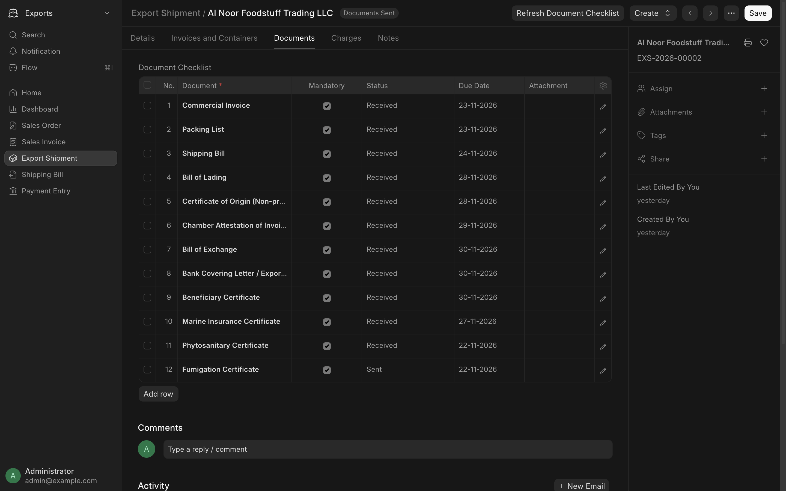

# India EXIM

Export–import compliance for Indian businesses on ERPNext v16, built on top of
[India Compliance](https://github.com/resilient-tech/india-compliance) (which keeps owning GST).

**Phase 1 (in progress)**

- Foreign-trade masters: ITC-HS tariff with dated duty rates, RoDTEP / Drawback rates with per-unit caps,
  CBIC customs exchange rates, Letter of Undertaking, AD code registrations, default EXIM accounts on Company.
- Exports: Export Shipment (route, cut-offs, containers, charges), Shipping Bill (FOB from Incoterm, customs
  exchange rate, incentives at LEO-date rates, accrual on LEO, realisation due date).
- Trade documents: country / country-group / product / Incoterm / payment-term / buyer rules merged into a
  per-shipment checklist, with due dates, readiness % and an optional block before documents go out.
- LUT check on zero-rated export invoices.

Law is stored as dated data (rate tables with effective dates and notification numbers), never hard-coded.
Rates shipped in tests are illustrative only — always load the notified schedules for real use.

## Screenshots

Recorded on a demo site with made-up data.

**Home page:** exports, incentives and imports at a glance


**Sales Invoice, Export Details tab:** shipping bill, realisation and shipment status on the invoice


**Shipping Bill:** FOB derived from a CIF invoice, Duty Drawback (with per-unit cap) and RoDTEP


**Export Shipment:** document checklist built from country, product and LC rules


**Bill of Entry:** customs duty from the tariff at the CBIC rate, feeding India Compliance's IGST, landed cost and import payment status


**Company, Export & Import tab:** IEC, RCMC and default export / import accounts


## Install

```bash
bench get-app https://github.com/resilient-tech/india-compliance --branch version-16
bench get-app <this repository>
bench --site <site> install-app india_exim
```

## Tests

```bash
bench --site <test-site> set-config allow_tests true
bench --site <test-site> run-tests --app india_exim
```

## License

GNU GPL v3

<!-- portfolio:start -->
---

<p align="center">
  <a href="https://yasirshaikh.in/?app=india-exim">
    <picture>
      <source media="(prefers-color-scheme: dark)" srcset="https://yasirshaikh.in/files/yasir-logo-on-dark.svg">
      
    </picture>
  </a>
</p>

<p align="center">
  Built by <a href="https://yasirshaikh.in/">Yasir Shaikh</a>, ERPNext consultant and Frappe developer.<br>
  <a href="https://yasirshaikh.in/?app=india-exim">See this app on my portfolio</a>
</p>
<!-- portfolio:end -->
