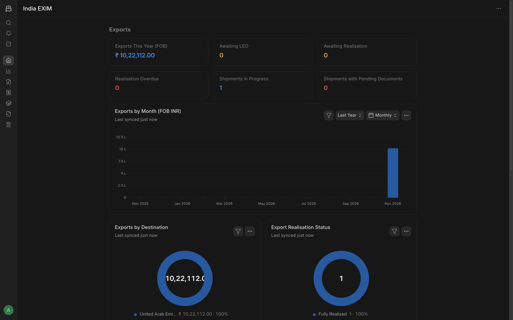
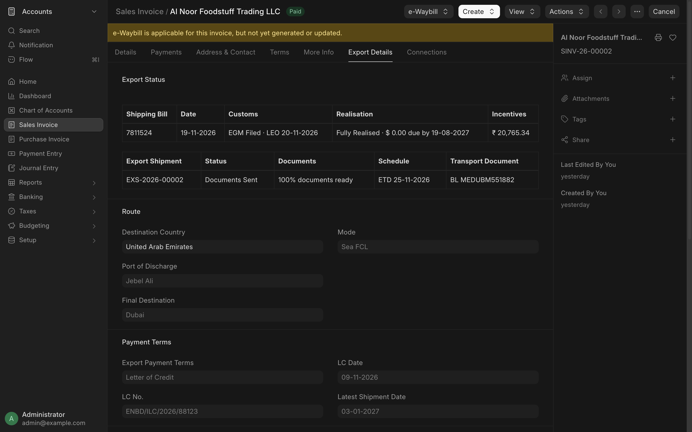
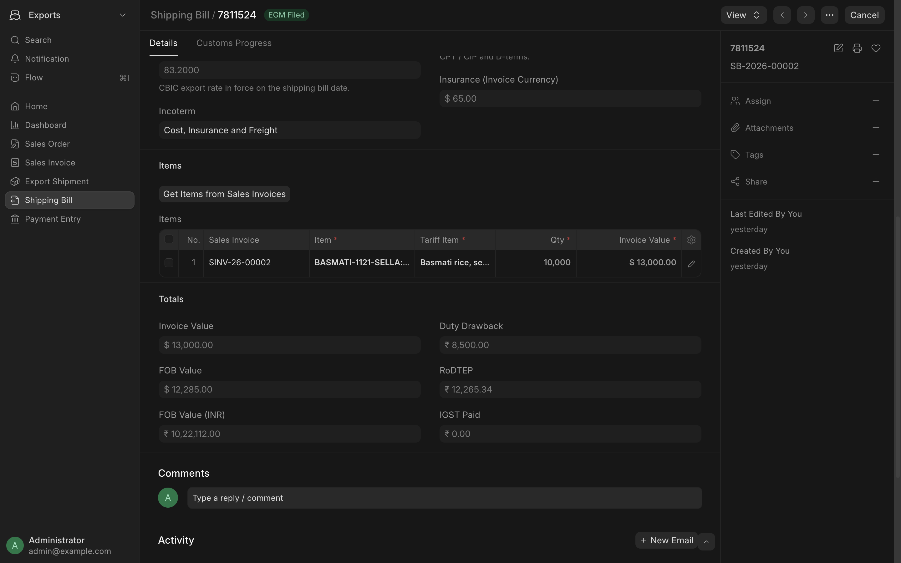
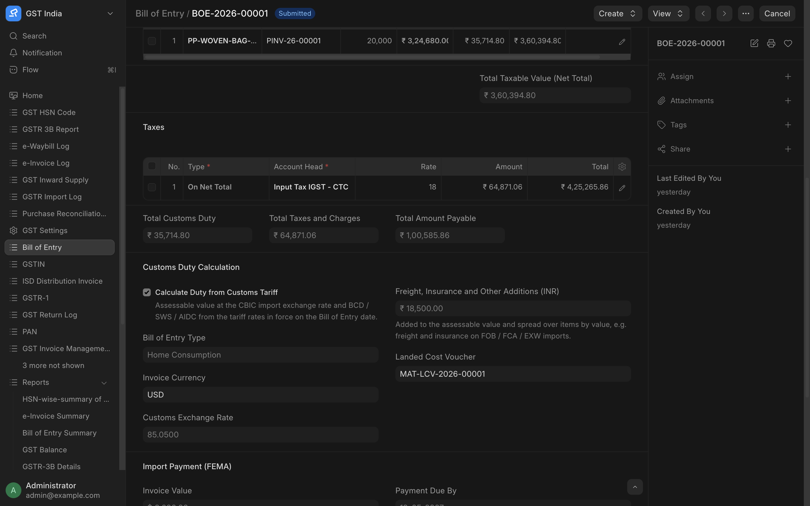
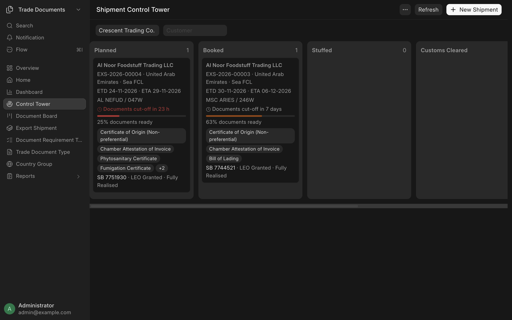
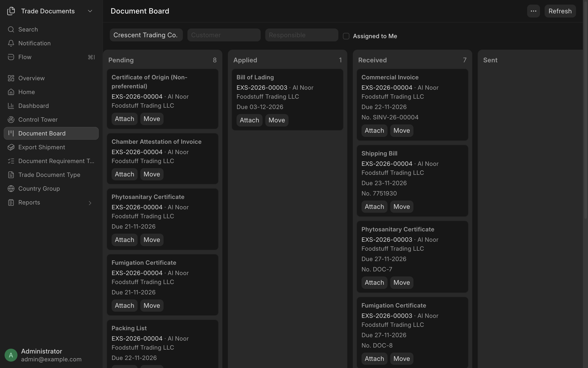
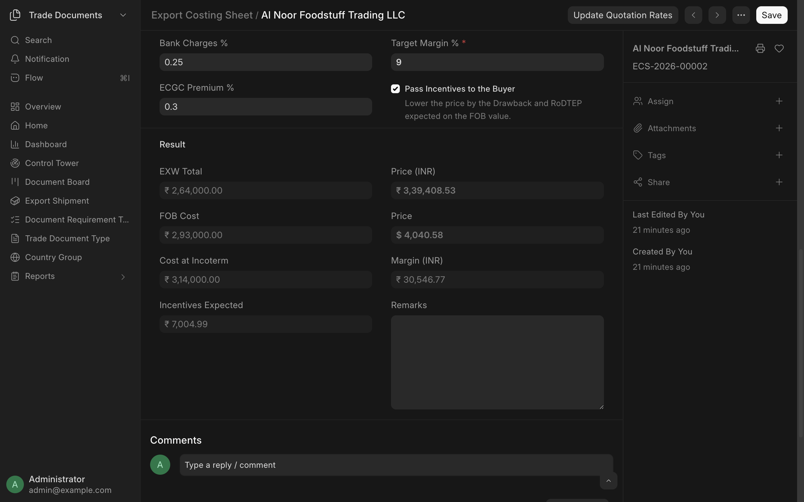
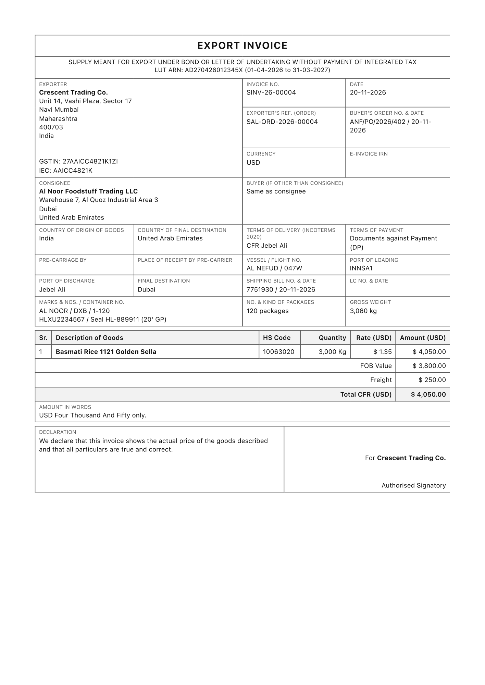
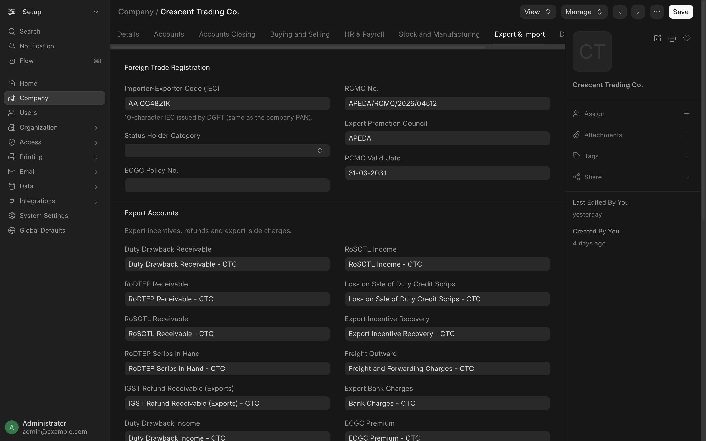

# India EXIM

Export–import compliance for Indian businesses on ERPNext v16, built on top of
[India Compliance](https://github.com/resilient-tech/india-compliance) (which keeps owning GST).

## What it does (Phase 1: exports and imports of goods)

- **Sales flow:** Quotation → Export Costing Sheet → Sales Order → Proforma Invoice → Delivery Note → Sales
  Invoice, with the export details (consignee, buyer, notify party, route, payment and LC terms, marks)
  carried through every step.
- **Foreign-trade masters:** ITC-HS tariff with dated duty rates and export policy, RoDTEP / Drawback rates
  with per-unit caps, CBIC customs exchange rates, Letter of Undertaking, AD codes, EXIM accounts on Company.
- **Shipments and documents:** Export Shipment (booking, cut-offs, containers, charges) with a document
  checklist built from country, product, Incoterm, payment-term and buyer rules. Shipment Control Tower and
  Document Board screens.
- **Shipping Bill:** FOB from the Incoterm, customs exchange rate, Drawback and RoDTEP accrued on LEO,
  proportionate reversal for credit notes and write-offs, agency commission, opening entries for go-live.
- **FEMA:** realisation from ordinary payments and credit notes, ageing, extensions and write-offs, export
  advances, import payment status per Bill of Entry.
- **Imports:** duty breakup on India Compliance's Bill of Entry, landed cost, RoDTEP scrip used against duty.
- **Incentives and refunds:** Export Incentive Claim, RoDTEP Scrip ledger, GST Refund Claim, merchant export at
  0.1% GST.
- **Controls:** LUT check on zero-rated invoices, destination and buyer screening, export policy and SCOMET
  checks on export orders.
- **Print formats:** Proforma Invoice, Export Invoice, Packing List, Bill of Exchange, Beneficiary
  Certificate, Bank Covering Letter, Shipping Instructions, VGM Declaration, Import Clearing Instructions.
- **Reports and alerts:** 12 reports, standard notifications and daily alerts for realisation, incentives,
  documents, LUT, scrips, advances and merchant exports. An evidence pack (one ZIP per Shipping Bill or Bill
  of Entry) for audits and enquiries.

See [docs/compliance-matrix.md](docs/compliance-matrix.md) for each legal requirement and where it is handled,
and [india_exim/setup/import_templates](india_exim/setup/import_templates) for go-live templates.

Law is stored as dated data (rate tables with effective dates and notification numbers), never hard-coded.
Rates shipped in tests are illustrative only — always load the notified schedules for real use.

## Screenshots

Recorded on a demo site with made-up data.

**Home page:** exports, incentives and imports at a glance


**Sales Invoice, Export Details tab:** shipping bill, realisation and shipment status on the invoice


**Shipping Bill:** FOB derived from a CIF invoice, Duty Drawback (with per-unit cap) and RoDTEP


**Export Shipment:** document checklist built from country, product and LC rules


**Bill of Entry:** customs duty from the tariff at the CBIC rate, feeding India Compliance's IGST, landed cost and import payment status


**Shipment Control Tower:** open shipments by stage, with the next cut-off, document readiness and shipping bill status


**Document Board:** every shipment's checklist documents by status; drag a card or attach the file in place


**Export Costing Sheet:** EXW to CFR / CIF price build-up with incentives, bank charges, ECGC and margin


**Export Invoice:** LUT declaration, consignee, route, FOB and freight split, container and seal numbers


**Company, Export & Import tab:** IEC, RCMC and default export / import accounts


## Install

```bash
bench get-app https://github.com/resilient-tech/india-compliance --branch version-16
bench get-app <this repository>
bench --site <site> install-app india_exim
```

## Tests

```bash
bench --site <test-site> set-config allow_tests true
bench --site <test-site> run-tests --app india_exim
```

## License

GNU GPL v3

<!-- portfolio:start -->
---

<p align="center">
  <a href="https://yasirshaikh.in/?app=india-exim">
    <picture>
      <source media="(prefers-color-scheme: dark)" srcset="https://yasirshaikh.in/files/yasir-logo-on-dark.svg">
      
    </picture>
  </a>
</p>

<p align="center">
  Built by <a href="https://yasirshaikh.in/">Yasir Shaikh</a>, ERPNext consultant and Frappe developer.<br>
  <a href="https://yasirshaikh.in/?app=india-exim">See this app on my portfolio</a>
</p>
<!-- portfolio:end -->
